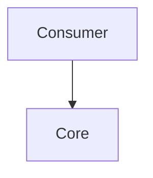

# Архитектура проекта
> Шаблон: заполнить подтверждёнными сведениями, неизвестное отметить Unknown. Не считать пример утверждённым решением.
## Назначение и ограничения
## Стек, платформы, сборка
## Ядро и границы ответственности
## Глобальный граф

Заменить пример фактическими модулями; стрелки означают зависимости, поток данных описывать отдельно.
## Реестр модулей
| Модуль | Назначение | Путь | Зависимости | Паспорт MODULE.md |
|---|---|---|---|---|
## Точки интеграции и контракты
## Порядок запуска и остановки
## Утверждённые инженерные решения
## Ограничения безопасности и производительности
## Открытые вопросы
