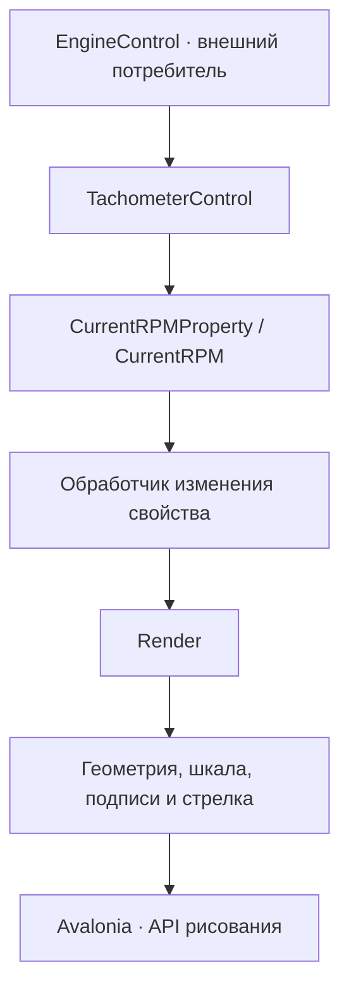

# Тахометр двигателя

## Назначение и границы ответственности

Контрол Avalonia рисует шкалу, красную зону и стрелку по входному значению RPM. Источник данных находится в HMI.

## Внутренний граф

## Публичные контракты

- `TachometerControl()` создаёт визуальный контрол.
- `CurrentRPMProperty: StyledProperty<double>` и `CurrentRPM: double` принимают обороты в минуту. Engine привязывает к ним `Pump1Rpm`.
- `Render(DrawingContext)` — переопределение Avalonia для рисования в текущих границах контрола.

## Зависимости и интеграция

Модуль использует свойства и графические примитивы Avalonia. Данные поступают по привязке из Engine. Изменение свойства инициирует перерисовку.

## Владение ресурсами и Lifetime

Контрол входит в визуальное дерево Engine. Ряд кистей и перьев хранится на экземпляре. Геометрии и часть оформительских объектов создаются внутри отрисовки. Собственного контракта освобождения ресурсов и подписки на CoreLink в контроле нет.

## Модель исполнения

Отрисовка вызывается системой рендеринга Avalonia. Свойство RPM инициирует инвалидирование визуала.

## Обработка ошибок и диагностика

Отдельный контракт результатов, обработки ошибок и диагностики у контрола отсутствует.

## Аллокации и ограничения производительности

При отрисовке создаются две `StreamGeometry` и отдельные объекты `Pen`. При формировании подписей шкалы внутри цикла создаются `FormattedText` и `Typeface`. Частота отрисовки и фактический объём аллокаций не измерены.

## Карта исходников

| Файл | Назначение |
|---|---|
| `TachometerControl.cs` | Свойство RPM, обработка изменения, отрисовка шкалы и стрелки |
| [EngineControl.axaml](../../Views/Menu/Engine/EngineControl.axaml) | Использование контрола и привязка RPM |

## Утверждённые решения

При переносе визуального компонента сохраняются его поведение, состояния и индикация. Действуют [общие требования переноса Legacy](../../../docs/ARCHITECTURE.md).

## Известные ограничения и открытые вопросы

Количество перерисовок и нагрузка при изменении RPM остаются неизвестными.
