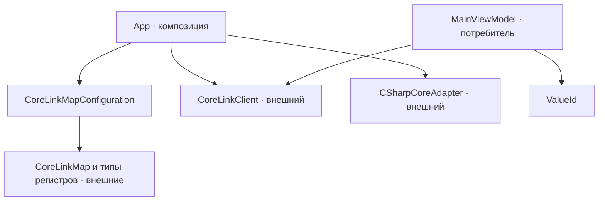

# Интеграция Nitrogen с CoreLink

## Назначение и границы ответственности

Модуль задаёт карту подключения и идентификаторы значений. CoreLink — отдельное бинарное ядро. Создание и остановка клиента принадлежат композиции приложения, подписки HMI принадлежат главной модели.

## Внутренний граф

## Публичные контракты

- `CoreLinkMapConfiguration.Create() → CoreLinkMap` создаёт карту. Адрес `127.0.0.1:1502`, Unit ID 255, код опроса 4, порядок регистров ABCD, системы единиц 1 и 2. Интервалы опроса и Rx — 500 мс, тайм-аут подключения — 3000 мс, тайм-аут запроса и задержка переподключения — 1000 мс.
- `ValueId` — перечисление с индексами 0–9. Значения соответствуют порядку записей текущей карты. `Measurme` и `StatOpko_1` описаны как `Word`. Остальные записи описаны как `Float`. Подписи единиц берутся из конфигурации записей карты.
- Используемый внешний API включает создание `CoreLinkClient` с `CSharpCoreAdapter`, `Start(map)`, `LastError`, `ObserveValue(int)` и `Stop()`.

## Зависимости и интеграция

Карта строится на `CoreLink.Contracts`. `Nitrogen.csproj` подключает бинарные Client, Contracts, Adapter.CSharp, Core, Transport, Maps, Rx и NModbus. При копировании DLL из `Bin` исключён локальный `System.Reactive.dll`. Композиция передаёт карту ядру, а HMI получает публикуемые клиентом значения.

## Владение ресурсами и Lifetime

`App` хранит единственный создаваемый при инициализации клиент. Карта создаётся при вызове `Start`. На Desktop `App` вызывает `Stop` после освобождения подписок главной модели. Для Activity и Single View явная остановка в `App` отсутствует. Владение внутренними ресурсами ядра неизвестно.

## Модель исполнения

Тайминги задаёт карта. Потоки опроса и публикации внутри бинарного ядра неизвестны. Переключение наблюдений на UI-планировщик выполняется потребителем в HMI.

## Обработка ошибок и диагностика

Композиция сравнивает ответ `Start` с `CoreLinkResult.Ok`, пишет в Trace результат и `LastError` при ошибке, затем продолжает запуск HMI. Длительность и результат запуска выводятся в консоль DEBUG-блоком. Полный контракт ошибок ядра неизвестен.

## Аллокации и ограничения производительности

Каждый вызов `Create` строит новую карту, набор записей и описания единиц. В штатной точке запуска это работа инициализации. Аллокации внутри бинарного ядра неизвестны.

## Карта исходников

| Файл | Назначение |
|---|---|
| `CoreLinkMapConfiguration.cs` | Настройки подключения, опроса и регистров |
| `ValueId.cs` | Индексы значений для `ObserveValue` |
| `Bin/*.dll` | Бинарная поставка ядра и зависимостей |
| [Nitrogen.csproj](../Nitrogen.csproj) | Ссылки и копирование бинарных компонентов |

## Утверждённые решения

Rx принадлежит CoreLink. Перенос Rx в Nitrogen и создание собственного реактивного транспорта запрещены. Если зависимость от функциональности CoreLink ещё недоступна, при переносе Legacy допускается только явная заглушка `TODO [CoreLink]` с описанием исходного поведения.

## Известные ограничения и открытые вопросы

Внутренний граф ядра, контракты завершения, полная модель ошибок и платформенная совместимость требуют подтверждения. Готовность конкретных команд оборудования отражена в [паспорте HMI](../Views/MODULE.md).
