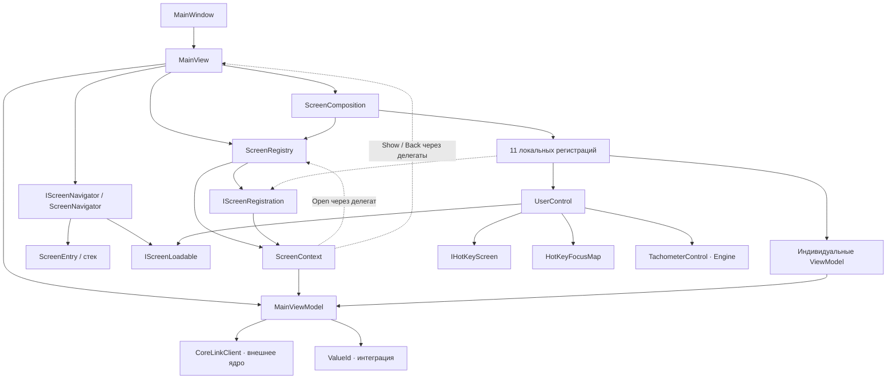

# Паспорт модуля HMI

## Назначение и границы ответственности

Модуль содержит главный экран HMI, Desktop-обёртку, модель данных телеметрии, клавиатурную маршрутизацию и стек дочерних экранов. В HMI также входят меню и прикладные экраны. Меню публикуют выбор оператора; локальные регистрации создают экраны, подключают события и передают владение ресурсами навигатору. Главный экран маршрутизирует ввод и обновляет контейнер и фокус.

## Навигация по экранам

[ScreenComposition](Navigation/ScreenComposition.cs) явно подключает 11 регистраций. [ScreenRegistry](Navigation/ScreenRegistry.cs) хранит регистрации по типу, а не экземпляры экранов. [ScreenContext](Navigation/ScreenContext.cs) предоставляет актуальную MainViewModel, открытие зарегистрированного экрана, показ и возврат.

| Источник | Маршруты |
|---|---|
| MainView | F1 Pressure, F2 Temperature, F3 ScfVolume, F4 Volume, F5 Engine, F8 Menu |
| Menu | F1 Pressure, F2 Temperature, F3 ScfVolume, F4 Volume, F5 Engine, F8 Settings |
| Settings | F1 PressureSet, F2 ScfSet, F5 DsPumpSet, F6 PsPumpSet |

Settings открывается только из Menu. ESC дочернего экрана возвращает вызывающий экран; при пустом стеке закрывает текущий экран и возвращает MainView.

## Внутренний граф

## Публичные контракты

- `MainWindow()` размещает `MainView` и передаёт ему клавиши окна.
- `MainView()` создаёт навигатор, контекст и реестр через ScreenComposition. Публичные методы `HandleKeyDown(KeyEventArgs)`, `ShowPressureScreen()`, `ShowEngineScreen()`, `ShowScfVolumeScreen()`, `ShowScreen(UserControl, IDisposable? ownedResource = null)`, `BackScreen()` и `CloseScreen()` маршрутизируют ввод и меняют содержимое контейнера.
- `MainViewModel(CoreLinkClient)` подписывается на девять значений. Публичные свойства привязки включают давление, порог и индикацию отсечки, температуры, RPM, расход и объёмы, время и регистры. Давление, порог и температуры форматируются строкой `0.##`. RPM, расход и SCF-значения представлены `double`. `UpdateOpkoAlarm(double)` меняет индикацию. `Dispose()` освобождает подписки.
- `IHotKeyScreen.HandleKey(Key)` — публичный контракт приёма клавиш. Внутренние контракты — `IScreenLoadable.LoadAsync(): Task`, а также `IScreenNavigator.ShowScreen(UserControl, IDisposable? ownedResource = null)`, `BackScreen()`, `CloseScreen()` и `Dispose()`.

### Меню и прикладные экраны

| Компонент | Контракт |
|---|---|
| `MenuControl` | `HandleKey(Key)`, события `CloseRequested`, `PressureRequested`, `EngineRequested`, `ScfVolumeRequested`, `TemperatureRequested` `VolumeRequested` и `SettingsRequested` |
| `SettingsControl` | `HandleKey(Key)`, события `CloseRequested`, `PressureSetRequested`, `ScfSetRequested`, `DsPumpSetRequested`, `PsPumpSetRequested` |
| PressureSet / SCFSet | `HandleKey(Key)`, `CloseRequested`, `LoadAsync(): Task`; собственные IDisposable ViewModel с заглушками LoadAsync/SaveAsync для CoreLink |
| DsPumpSet / PsPumpSet | `HandleKey(Key)`, `CloseRequested`; без собственной ViewModel |
| Дочерние контролы | `HandleKey(Key)` и событие `CloseRequested`. Pressure, Engine и ScfVolume также предоставляют `LoadAsync(): Task` |
| `PressureViewModel` | Принимает `MainViewModel`, предоставляет `Pressure_1`, `PressureTileBackground` и редактируемый `OpkoEdit`. Методы `LoadAsync`, `SetZero`, `ResetZero`, `SetShutdown` и `Dispose` |
| `PressureWriteRequest` | Свойства `Command: PressureCommand` и `Value: float?`. Фабрики `SetZero()`, `ResetZero()` и `SetShutdown(float)` |
| `EngineViewModel` | Принимает `MainViewModel`, предоставляет `Pump1Rpm` в оборотах в минуту и `Pump1Hours` в часах. Методы `LoadAsync`, `Neutral`, `Up`, `Down` и `Dispose` |
| `ScfVolumeControlViewModel` | Принимает `MainViewModel`, предоставляет строковые свойства редактирования общих и насосных объёмов за стадию и работу. `LoadAsync` форматирует значения как `0.###` с `InvariantCulture` |

## Внутренний контракт регистрации и правила расширения

- `IScreenRegistration.Open(ScreenContext): bool` — единственный обязательный метод. true означает передачу созданного экрана навигатору, а не завершение асинхронной загрузки; false — экран не открыт.
- `ScreenRegistry.Register<T>(T): bool` и `Open<T>(): bool` ограничены типами class, IScreenRegistration. Идентификатор — typeof(T); строк, общего enum и автоматического поиска через Reflection нет.
- `ScreenContext.MainViewModel` получает актуальную модель через делегат; `Open<T>()` запрашивает другой зарегистрированный экран, `ShowScreen(UserControl, IDisposable? ownedResource = null)` передаёт экран и ресурс, `BackScreen()` возвращает назад.
- Один экран — одна папка. Файл Registration.cs располагается рядом с View и ViewModel; отдельная папка Infrastructure ради одного файла не создаётся.
- Новый экран реализует контракт, создаёт новый контрол и необходимые модели только в Open, подключает CloseRequested к BackScreen, а переходы — к Open<T>. При необходимой, но отсутствующей MainViewModel возвращает false.
- Индивидуальный IDisposable ресурс передаётся навигатору явно; общая MainViewModel не передаётся во владение. Регистрация не хранит созданные экземпляры, не управляет стеком и фокусом и не содержит прикладных вычислений.
- Подключить регистрацию одной строкой Register в ScreenComposition и добавить маршрут в вызывающем экране. Алгоритмы реестра и навигатора при обычном расширении не изменяются.
- Проверить сборку, открытие из предусмотренных источников, горячие клавиши, фокус, возврат, повторное открытие и освобождение подписок. Сохранять существующие контракты и поведение Legacy.

## Зависимости и интеграция

Используются Avalonia, ReactiveUI, System.Reactive, API ядра и ValueId. Temperature и Volume используют общую MainViewModel; Pressure, Engine, ScfVolume, PressureSet и SCFSet — индивидуальные модели. Engine использует контрол тахометра. Запись команд и калибровок в CoreLink остаётся TODO.

## Владение ресурсами и Lifetime

MainViewModel владеет CompositeDisposable. На Desktop его освобождает App при выходе. Для Activity модель создаётся при каждом вызове фабрики. Для Activity и Single View явное освобождение в App отсутствует.

Реестр, контекст и регистрации живут вместе с MainView. Контролы и индивидуальные модели создаются по запросу; предварительного создания, пулов и кеширования нет. Навигатор хранит только текущий экран и путь возврата. Pressure, Engine, PressureSet и SCFSet передают IDisposable модели в ScreenEntry. ScfVolume передаёт только контрол; Temperature и Volume используют общую модель без передачи владения.

BackScreen освобождает текущую запись, очищает DataContext и вызывает Dispose переданного ресурса, затем восстанавливает предыдущую запись либо оставляет контейнер пустым. CloseScreen освобождает все записи; Dispose навигатора вызывает CloseScreen. Управляемая память освобождается GC после исчезновения ссылок, принудительный GC не используется. Вызов Dispose навигатора при завершении приложения ещё не подключён.

## Модель исполнения

Наблюдения CoreLink переключаются через WitnessOn(RxSchedulers.MainThreadScheduler). Навигатор запускает LoadAsync при новом открытии без ожидания; возврат не запускает повторную загрузку. ScfVolume больше не загружается отдельно из MainView. MainView обновляет видимость контейнера и фокус после навигации.

## Обработка ошибок и диагностика

Повторная регистрация в ScreenComposition вызывает InvalidOperationException. Отсутствующая регистрация или необходимая модель возвращает false; вызывающие обработчики пока не используют результат. Ошибки создания, передачи владения при исключении и асинхронной загрузки отдельно не обработаны. Отмена загрузки при закрытии не реализована. Контракт результата записи CoreLink отсутствует.

## Аллокации и ограничения производительности

При открытии создаются контрол, обработчики, ScreenEntry и при необходимости индивидуальная модель. При возврате предыдущий экземпляр сохраняется. Форматирование телеметрии и редактируемых значений создаёт строки. Частота отрисовок и объём аллокаций не измерены.

## Карта исходников

| Файл | Назначение |
|---|---|
| `MainView/MainView.axaml`, `MainView/MainView.axaml.cs` | Привязки главного экрана, контейнер, запросы открытия, фокус и маршрутизация клавиш |
| `MainView/MainViewModel.cs` | Подписки CoreLink, свойства HMI и индикация |
| `MainWindow/MainWindow.axaml*` | Desktop-обёртка и передача клавиш |
| `MainWindow/ScreenHost/*.cs` | Внутренний контракт навигатора и стек |
| `Interfaces/*.cs` | Контракты клавиатуры, загрузки и регистрации |
| `Navigation/ScreenComposition.cs` | Явная композиция регистраций |
| `Navigation/ScreenRegistry.cs`, `Navigation/ScreenContext.cs` | Типизированное открытие и контекст |
| `Menu/**/*Registration.cs`, `Settings/**/*Registration.cs` | Локальная композиция экранов и маршруты |
| `Settings/SettingsControl.axaml*` | Меню настроек |
| `Settings/PressureSet/*`, `Settings/SCFSet/*` | Калибровки, модели и заглушки CoreLink |
| `Settings/DsPumpSet/*`, `Settings/PumpSet/*` | Настройки насосов |
| `Common/HotKeyFocusMap.cs` | Связь клавиш с полями ввода |
| `Menu/MenuControl.axaml*` | Выбор экрана и события меню |
| `Menu/Pressure/PressureControl.axaml*`, `Menu/Pressure/PressureViewModel.cs` | Индикация давления, ввод порога, точки обработки действий |
| `Menu/Pressure/PressureCommand.cs`, `Menu/Pressure/PressureWriteRequest.cs` | Тип команды и модель запроса |
| `Menu/Engine/EngineControl.axaml*`, `Menu/Engine/EngineViewModel.cs` | RPM, тахометр, часы и действия трансмиссии |
| `Menu/ScfVolume/ScfVolumeControl.axaml*`, `Menu/ScfVolume/ScfVolumeControlViewModel.cs` | Отображение и редактирование объёмов SCF |
| `Menu/Temperature/TemperatureControl.axaml*` | Экран температур |
| `Menu/Volume/VolumeControl.axaml*` | Экран объёмов и точки обработки действий |

## Утверждённые решения

При переносе Legacy сохраняются маршрутизация горячих клавиш, фокус, выделение текста, переходы, закрытие, состояние и индикация. Общие критерии полноты и проверки установлены в [глобальной архитектуре](../../docs/ARCHITECTURE.md).

Экран переносится целиком. Перед выдачей проверяются XAML, code-behind, привязки, события, обработчики, команды, клавиши, фокус, навигация, закрытие, ViewModel, вспомогательные классы и зависимости. Каждый предоставляемый файл сравнивается с Legacy с обязательной проверкой отсутствия необоснованных изменений и проверкой связанных файлов. Возвращаться к завершённому экрану за функциональностью, пропущенной при первоначальном переносе, запрещено. Допустимые основания для повторных изменений и исключение для CoreLink закреплены в [глобальной архитектуре](../../docs/ARCHITECTURE.md).

## Известные ограничения и открытые вопросы

Открытие Record остаётся TODO. Фактические объёмы цемента не подключены к CoreLink в главной модели. Stages также не реализован. Порядок завершения навигатора и очистки главной модели на Activity и Single View требует уточнения.

### Прикладные экраны

- Pressure. Запись команд установки и сброса нуля и установки порога остаётся TODO.
- Engine. Чтение часов и запись команд трансмиссии остаются TODO.
- ScfVolume. Часть отображаемых значений демонстрационная. Чтение из CoreLink, установка и сброс объёмов стадии и работы остаются TODO.
- Volume. Установка и сброс объёмов остаются TODO.

- PressureSet и SCFSet. Чтение и сохранение калибровок остаются заглушками TODO [CoreLink].
- DsPumpSet и PsPumpSet. Статические экраны без моделей и интеграции с оборудованием.
