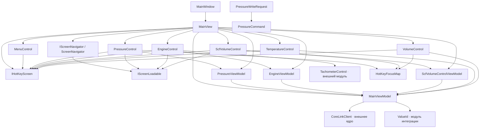

# Паспорт модуля HMI

## Назначение и границы ответственности

Модуль содержит главный экран HMI, Desktop-обёртку, модель данных телеметрии, клавиатурную маршрутизацию и стек дочерних экранов. В HMI также входят меню и прикладные экраны. Меню публикует выбор оператора, главный экран открывает выбранный контрол, а прикладные экраны отображают свойства `MainViewModel` и обрабатывают локальный ввод.

## Навигация по экранам

Точки создания экранов и подключение событий находятся в [MainView.axaml.cs](MainView/MainView.axaml.cs). Контракты описаны в [разделе экранов](#меню-и-прикладные-экраны), пути к XAML и ViewModel — в [карте исходников](#карта-исходников).

- [Меню](Menu/MenuControl.axaml.cs)
- [Pressure](Menu/Pressure/PressureControl.axaml.cs)
- [Engine](Menu/Engine/EngineControl.axaml.cs)
- [ScfVolume](Menu/ScfVolume/ScfVolumeControl.axaml.cs)
- [Temperature](Menu/Temperature/TemperatureControl.axaml.cs)
- [Volume](Menu/Volume/VolumeControl.axaml.cs)

## Внутренний граф

## Публичные контракты

- `MainWindow()` размещает `MainView` и передаёт ему клавиши окна.
- `MainView()` создаёт навигатор для своего контейнера. Публичные методы `HandleKeyDown(KeyEventArgs)`, `ShowPressureScreen()`, `ShowEngineScreen()`, `ShowScfVolumeScreen()`, `ShowScreen(UserControl)`, `BackScreen()` и `CloseScreen()` маршрутизируют ввод и меняют содержимое контейнера.
- `MainViewModel(CoreLinkClient)` подписывается на девять значений. Публичные свойства привязки включают давление, порог и индикацию отсечки, температуры, RPM, расход и объёмы, время и регистры. Давление, порог и температуры форматируются строкой `0.##`. RPM, расход и SCF-значения представлены `double`. `UpdateOpkoAlarm(double)` меняет индикацию. `Dispose()` освобождает подписки.
- `IHotKeyScreen.HandleKey(Key)` — публичный контракт приёма клавиш. Внутренние контракты — `IScreenLoadable.LoadAsync(): Task`, а также `IScreenNavigator.ShowScreen(UserControl)`, `BackScreen()` и `CloseScreen()`.

### Меню и прикладные экраны

| Компонент | Контракт |
|---|---|
| `MenuControl` | `HandleKey(Key)`, события `CloseRequested`, `PressureRequested`, `EngineRequested`, `ScfVolumeRequested`, `TemperatureRequested` и `VolumeRequested` |
| Дочерние контролы | `HandleKey(Key)` и событие `CloseRequested`. Pressure, Engine и ScfVolume также предоставляют `LoadAsync(): Task` |
| `PressureViewModel` | Принимает `MainViewModel`, предоставляет `Pressure_1`, `PressureTileBackground` и редактируемый `OpkoEdit`. Методы `LoadAsync`, `SetZero`, `ResetZero`, `SetShutdown` и `Dispose` |
| `PressureWriteRequest` | Свойства `Command: PressureCommand` и `Value: float?`. Фабрики `SetZero()`, `ResetZero()` и `SetShutdown(float)` |
| `EngineViewModel` | Принимает `MainViewModel`, предоставляет `Pump1Rpm` в оборотах в минуту и `Pump1Hours` в часах. Методы `LoadAsync`, `Neutral`, `Up`, `Down` и `Dispose` |
| `ScfVolumeControlViewModel` | Принимает `MainViewModel`, предоставляет строковые свойства редактирования общих и насосных объёмов за стадию и работу. `LoadAsync` форматирует значения как `0.###` с `InvariantCulture` |

## Зависимости и интеграция

Используются Avalonia, ReactiveUI, System.Reactive, API ядра и `ValueId`. `MainView` создаёт дочерние экраны. Их модели и привязки потребляют свойства `MainViewModel`. `ScreenNavigator` держит предыдущие экраны в стеке, возвращает верхний при переходе назад и очищает стек при закрытии.

Экраны используют общие UI-контракты. Temperature и Volume связываются с `MainViewModel` напрямую через `DataContext`. Pressure, Engine и ScfVolume получают данные через свои ViewModel. Engine передаёт RPM в отдельный контрол тахометра. В текущей реализации запись команд в CoreLink остаётся TODO.

## Владение ресурсами и Lifetime

`MainViewModel` владеет `CompositeDisposable`. На Desktop его освобождает `App` при выходе. Для Activity модель создаётся при каждом вызове фабрики. Для Activity и Single View явное освобождение в `App` отсутствует.

Оболочка создаёт контролы и модели. Pressure и Engine подписываются на `PropertyChanged` главной модели и снимают подписку в `Dispose`. `MainView` вызывает его при `CloseRequested`. Очистка стека навигатора сама по себе освобождение моделей не вызывает. Для ScfVolume оболочка вызывает загрузку модели напрямую перед показом, а навигатор запускает её повторно через контрол.

## Модель исполнения

Наблюдения CoreLink переключаются через `WitnessOn(RxSchedulers.MainThreadScheduler)`. Навигатор запускает асинхронную загрузку при открытии экрана и не ждёт её окончания. Возврат через стек меняет содержимое контейнера.

Контролы обрабатывают события Avalonia и клавиши. Текущие методы загрузки моделей завершаются через `Task.CompletedTask`. ScfVolume перед завершением заполняет редактируемые строки.

## Обработка ошибок и диагностика

При отсутствии ожидаемого `DataContext` методы открытия Pressure, Engine и ScfVolume завершаются без открытия. Возврат при пустом стеке оставляет текущий экран. Обработка ошибок и Lifetime `LoadAsync` отмечены в навигаторе как TODO. Подписки в главной модели задают обработчик значения, отдельный обработчик ошибки в месте подписки отсутствует.

При отсутствии подходящего `DataContext` загрузка через контролы возвращает завершённую задачу. Контракт результата записи в CoreLink в этих экранах отсутствует.

## Аллокации и ограничения производительности

При каждом открытии создаются новый контрол и обработчик закрытия, а для Pressure, Engine и ScfVolume также новая модель. Обновление давления, порога и температур форматирует числовые значения в строки. ScfVolume форматирует четыре значения в строки при каждом вызове загрузки. На текущем пути открытия оба вызова выполняют форматирование. Частота отрисовок и фактический объём аллокаций не измерены.

## Карта исходников

| Файл | Назначение |
|---|---|
| `MainView/MainView.axaml`, `MainView/MainView.axaml.cs` | Привязки главного экрана, контейнер, создание экранов и маршрутизация клавиш |
| `MainView/MainViewModel.cs` | Подписки CoreLink, свойства HMI и индикация |
| `MainWindow/MainWindow.axaml*` | Desktop-обёртка и передача клавиш |
| `MainWindow/ScreenHost/*.cs` | Внутренний контракт навигатора и стек |
| `Interfaces/*.cs` | Контракты клавиатуры и загрузки |
| `Common/HotKeyFocusMap.cs` | Связь клавиш с полями ввода |
| `Menu/MenuControl.axaml*` | Выбор экрана и события меню |
| `Menu/Pressure/PressureControl.axaml*`, `Menu/Pressure/PressureViewModel.cs` | Индикация давления, ввод порога, точки обработки действий |
| `Menu/Pressure/PressureCommand.cs`, `Menu/Pressure/PressureWriteRequest.cs` | Тип команды и модель запроса |
| `Menu/Engine/EngineControl.axaml*`, `Menu/Engine/EngineViewModel.cs` | RPM, тахометр, часы и действия трансмиссии |
| `Menu/ScfVolume/ScfVolumeControl.axaml*`, `Menu/ScfVolume/ScfVolumeControlViewModel.cs` | Отображение и редактирование объёмов SCF |
| `Menu/Temperature/TemperatureControl.axaml*` | Экран температур |
| `Menu/Volume/VolumeControl.axaml*` | Экран объёмов и точки обработки действий |

## Утверждённые решения

При переносе Legacy сохраняются маршрутизация горячих клавиш, фокус, выделение текста, переходы, закрытие, состояние и индикация. Общие критерии полноты и проверки установлены в [глобальной архитектуре](../../docs/ARCHITECTURE.md).

Экран переносится целиком. Перед выдачей проверяются XAML, code-behind, привязки, события, обработчики, команды, клавиши, фокус, навигация, закрытие, ViewModel, вспомогательные классы и зависимости. Каждый предоставляемый файл сравнивается с Legacy с обязательной проверкой отсутствия необоснованных изменений и проверкой связанных файлов. Возвращаться к завершённому экрану за функциональностью, пропущенной при первоначальном переносе, запрещено. Допустимые основания для повторных изменений и исключение для CoreLink закреплены в [глобальной архитектуре](../../docs/ARCHITECTURE.md).

## Известные ограничения и открытые вопросы

Открытие Record остаётся TODO. Фактические объёмы цемента не подключены к CoreLink в главной модели. Порядок очистки моделей на платформах Activity и Single View и при закрытии экрана в обход `CloseRequested` требует уточнения.

### Прикладные экраны

- Pressure. Запись команд установки и сброса нуля и установки порога остаётся TODO.
- Engine. Чтение часов и запись команд трансмиссии остаются TODO.
- ScfVolume. Часть отображаемых значений демонстрационная. Чтение из CoreLink, установка и сброс объёмов стадии и работы остаются TODO.
- Volume. Установка и сброс объёмов остаются TODO.
