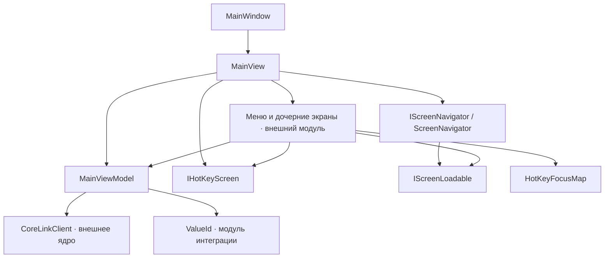

# Главный экран и навигация

## Назначение и границы ответственности

Модуль содержит главный экран HMI, Desktop-обёртку, модель данных телеметрии, клавиатурную маршрутизацию и стек дочерних экранов.

## Внутренний граф

## Публичные контракты

- `MainWindow()` размещает `MainView` и передаёт ему клавиши окна.
- `MainView()` создаёт навигатор для своего контейнера. Публичные методы `HandleKeyDown(KeyEventArgs)`, `ShowPressureScreen()`, `ShowEngineScreen()`, `ShowScfVolumeScreen()`, `ShowScreen(UserControl)`, `BackScreen()` и `CloseScreen()` маршрутизируют ввод и меняют содержимое контейнера.
- `MainViewModel(CoreLinkClient)` подписывается на девять значений. Публичные свойства привязки включают давление, порог и индикацию отсечки, температуры, RPM, расход и объёмы, время и регистры. Давление, порог и температуры форматируются строкой `0.##`. RPM, расход и SCF-значения представлены `double`. `UpdateOpkoAlarm(double)` меняет индикацию. `Dispose()` освобождает подписки.
- `IHotKeyScreen.HandleKey(Key)` — публичный контракт приёма клавиш. Внутренние контракты — `IScreenLoadable.LoadAsync(): Task`, а также `IScreenNavigator.ShowScreen(UserControl)`, `BackScreen()` и `CloseScreen()`.

## Зависимости и интеграция

Используются Avalonia, ReactiveUI, System.Reactive, API ядра и `ValueId`. `MainView` создаёт дочерние экраны. Их модели и привязки потребляют свойства `MainViewModel`. `ScreenNavigator` держит предыдущие экраны в стеке, возвращает верхний при переходе назад и очищает стек при закрытии.

## Владение ресурсами и Lifetime

`MainViewModel` владеет `CompositeDisposable`. На Desktop его освобождает `App` при выходе. Для Activity модель создаётся при каждом вызове фабрики. Для Activity и Single View явное освобождение в `App` отсутствует. `MainView` вызывает `Dispose()` у Pressure и Engine в их обработчиках `CloseRequested`. Очистка стека навигатора сама по себе освобождение моделей не вызывает.

## Модель исполнения

Наблюдения CoreLink переключаются через `WitnessOn(RxSchedulers.MainThreadScheduler)`. Навигатор запускает асинхронную загрузку при открытии экрана и не ждёт её окончания. Возврат через стек меняет содержимое контейнера.

## Обработка ошибок и диагностика

При отсутствии ожидаемого `DataContext` методы открытия Pressure, Engine и ScfVolume завершаются без открытия. Возврат при пустом стеке оставляет текущий экран. Обработка ошибок и Lifetime `LoadAsync` отмечены в навигаторе как TODO. Подписки в главной модели задают обработчик значения, отдельный обработчик ошибки в месте подписки отсутствует.

## Аллокации и ограничения производительности

Открытие экрана создаёт экземпляр контрола и, где предусмотрено, ViewModel и обработчик закрытия. Обновление давления, порога и температур форматирует числовые значения в строки. Частота отрисовок и фактический объём аллокаций не измерены.

## Карта исходников

| Файл | Назначение |
|---|---|
| `MainView.axaml`, `MainView.axaml.cs` | Привязки главного экрана, контейнер, создание экранов и маршрутизация клавиш |
| `MainViewModel.cs` | Подписки CoreLink, свойства HMI и индикация |
| `../MainWindow/MainWindow.axaml*` | Desktop-обёртка и передача клавиш |
| `../MainWindow/ScreenHost/*.cs` | Внутренний контракт навигатора и стек |
| `../Interfaces/*.cs` | Контракты клавиатуры и загрузки |
| `../Common/HotKeyFocusMap.cs` | Связь клавиш с полями ввода |

## Утверждённые решения

При переносе Legacy сохраняются маршрутизация горячих клавиш, фокус, выделение текста, переходы, закрытие, состояние и индикация. Общие критерии полноты и проверки установлены в [глобальной архитектуре](../../../docs/ARCHITECTURE.md).

## Известные ограничения и открытые вопросы

Открытие Record остаётся TODO. Фактические объёмы цемента не подключены к CoreLink в главной модели. Порядок очистки моделей на платформах Activity и Single View и при закрытии экрана в обход `CloseRequested` требует уточнения.
