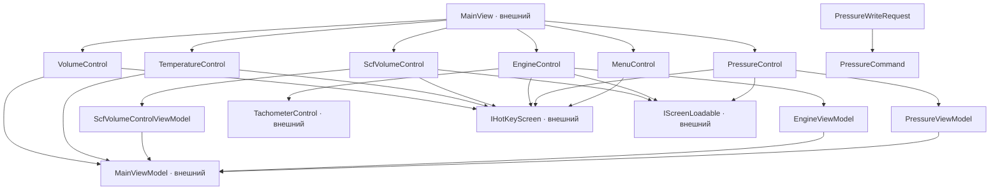

# Меню и прикладные экраны

## Назначение и границы ответственности

Модуль открывает прикладные экраны по выбору пользователя, отображает свойства HMI и обрабатывает локальный ввод. Композиция экранов и управление стеком принадлежат главному экрану. Телеметрия приходит через `MainViewModel`.

## Внутренний граф

## Публичные контракты

| Компонент | Контракт |
|---|---|
| `MenuControl` | `HandleKey(Key)`, события `CloseRequested`, `PressureRequested`, `EngineRequested`, `ScfVolumeRequested`, `TemperatureRequested` и `VolumeRequested` |
| Дочерние контролы | `HandleKey(Key)` и событие `CloseRequested`. Pressure, Engine и ScfVolume также предоставляют `LoadAsync(): Task` |
| `PressureViewModel` | Принимает `MainViewModel`, предоставляет `Pressure_1`, `PressureTileBackground` и редактируемый `OpkoEdit`. Методы `LoadAsync`, `SetZero`, `ResetZero`, `SetShutdown` и `Dispose` |
| `PressureWriteRequest` | Свойства `Command: PressureCommand` и `Value: float?`. Фабрики `SetZero()`, `ResetZero()` и `SetShutdown(float)` |
| `EngineViewModel` | Принимает `MainViewModel`, предоставляет `Pump1Rpm` в оборотах в минуту и `Pump1Hours` в часах. Методы `LoadAsync`, `Neutral`, `Up`, `Down` и `Dispose` |
| `ScfVolumeControlViewModel` | Принимает `MainViewModel`, предоставляет строковые свойства редактирования общих и насосных объёмов за стадию и работу. `LoadAsync` форматирует значения как `0.###` с `InvariantCulture` |

## Зависимости и интеграция

Экраны используют Avalonia, ReactiveUI, общие UI-контракты и свойства `MainViewModel`. Temperature и Volume связываются с ним напрямую через `DataContext`. Pressure, Engine и ScfVolume получают данные через свои ViewModel. Engine передаёт RPM в отдельный контрол тахометра. В текущей реализации запись команд в CoreLink остаётся TODO.

## Владение ресурсами и Lifetime

Оболочка создаёт контролы и модели. Pressure и Engine подписываются на `PropertyChanged` главной модели и снимают подписку в `Dispose`. Оболочка вызывает его при `CloseRequested`. Очистка стека навигации сама по себе не вызывает `Dispose`. Для ScfVolume оболочка вызывает загрузку модели напрямую перед показом, а навигатор запускает её повторно через контрол.

## Модель исполнения

Контролы обрабатывают события Avalonia и клавиши. Навигатор инициирует `LoadAsync` без ожидания результата. Текущие методы загрузки моделей завершаются через `Task.CompletedTask`. ScfVolume перед завершением заполняет редактируемые строки.

## Обработка ошибок и диагностика

При отсутствии подходящего `DataContext` загрузка через контролы возвращает завершённую задачу. Контракт результата записи в CoreLink в этих экранах отсутствует. Ошибки асинхронной загрузки остаются открытым вопросом навигатора.

## Аллокации и ограничения производительности

При каждом открытии создаются новый контрол и обработчик закрытия, а для Pressure, Engine и ScfVolume также новая модель. ScfVolume форматирует четыре значения в строки при каждом вызове загрузки. На текущем пути открытия оба вызова выполняют форматирование. Количественных замеров нет.

## Карта исходников

| Файл или каталог | Назначение |
|---|---|
| `MenuControl.axaml*` | Выбор экрана и события меню |
| `Pressure/PressureControl.axaml*`, `Pressure/PressureViewModel.cs` | Индикация давления, ввод порога, точки обработки действий |
| `Pressure/PressureCommand.cs`, `Pressure/PressureWriteRequest.cs` | Тип команды и модель запроса |
| `Engine/EngineControl.axaml*`, `Engine/EngineViewModel.cs` | RPM, тахометр, часы и действия трансмиссии |
| `ScfVolume/ScfVolumeControl.axaml*`, `ScfVolume/ScfVolumeControlViewModel.cs` | Отображение и редактирование объёмов SCF |
| `Temperature/TemperatureControl.axaml*` | Экран температур |
| `Volume/VolumeControl.axaml*` | Экран объёмов и точки обработки действий |

## Утверждённые решения

Экран переносится целиком. Перед выдачей проверяются XAML, code-behind, привязки, события, обработчики, команды, клавиши, фокус, навигация, закрытие, ViewModel, вспомогательные классы и зависимости. Каждый предоставляемый файл сравнивается с Legacy с обязательной проверкой отсутствия необоснованных изменений и проверкой связанных файлов. Возвращаться к завершённому экрану за функциональностью, пропущенной при первоначальном переносе, запрещено. Допустимые основания для повторных изменений и исключение для CoreLink закреплены в [глобальной архитектуре](../../../docs/ARCHITECTURE.md).

## Известные ограничения и открытые вопросы

- Pressure. Запись команд установки и сброса нуля и установки порога остаётся TODO.
- Engine. Чтение часов и запись команд трансмиссии остаются TODO.
- ScfVolume. Часть отображаемых значений демонстрационная. Чтение из CoreLink, установка и сброс объёмов стадии и работы остаются TODO.
- Volume. Установка и сброс объёмов остаются TODO.
