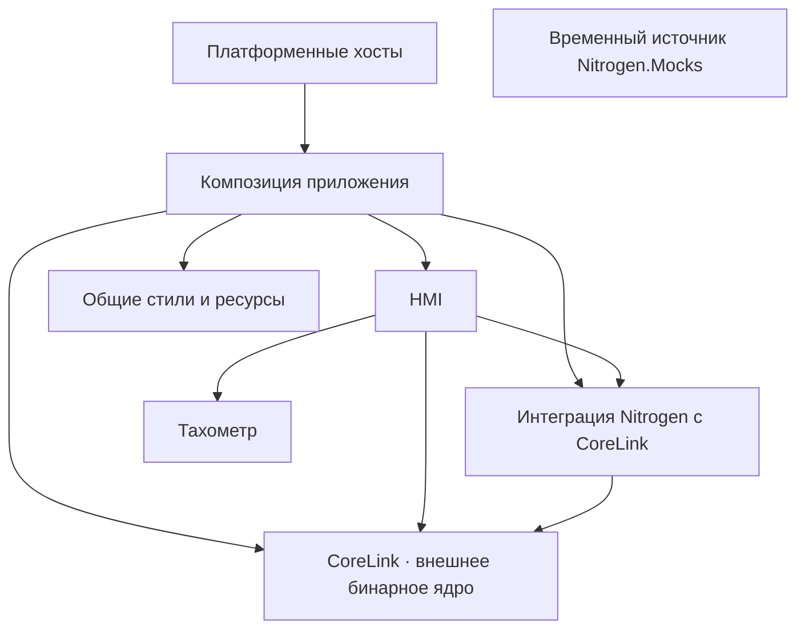

# Архитектура Nitrogen

## Назначение и ограничения

Nitrogen — HMI на Avalonia. Интерфейс показывает телеметрию и предоставляет экраны давления, двигателя, температуры и объёмов. CoreLink — внешнее бинарное ядро проекта. Код Nitrogen содержит конфигурацию интеграции, композицию приложения и HMI.

## Стек, платформы и сборка

Общий проект использует C# и .NET 10, Avalonia 12.1.3, ReactiveUI и System.Reactive. Версии пакетов заданы в [Directory.Packages.props](../Directory.Packages.props). [Nitrogen.slnx](../Nitrogen.slnx) включает Desktop, Android, Browser и общий проект. Проект iOS присутствует в дереве и закомментирован в решении. Все четыре хоста ссылаются на общий проект. CoreLink подключается через локальные DLL по путям из [Nitrogen.csproj](../Nitrogen/Nitrogen.csproj).

## Ядро и границы ответственности

CoreLink владеет Rx и предоставляет используемый HMI поток телеметрии. Переносить Rx из CoreLink в Nitrogen и создавать в Nitrogen собственный реактивный транспорт запрещено. HMI подписывается на значения и обновляет свойства привязки. Модуль интеграции в `Nitrogen/CoreLink/` задаёт карту и идентификаторы значений для клиента ядра. Поставляемые DLL находятся в `Nitrogen/CoreLink/Bin/`.

## Глобальный граф

Стрелки показывают зависимости от потребителя к поставщику. Главный экран, навигация, меню и прикладные экраны образуют единый модуль HMI. Связи между его компонентами показаны в [паспорте HMI](../Nitrogen/Views/MODULE.md).

## Реестр модулей

| Модуль | Назначение | Путь от корня | Зависимости | Паспорт |
|---|---|---|---|---|
| Платформенные хосты | Запуск и конфигурация Avalonia | `Nitrogen.Desktop/`, `Nitrogen.Android/`, `Nitrogen.Browser/`, `Nitrogen.iOS/` | Композиция, платформенные пакеты Avalonia | Здесь |
| Композиция приложения | Запуск ядра, загрузка ресурсов, выбор интерфейса по Lifetime | `Nitrogen/App.axaml*` | CoreLink, интеграция, HMI, ресурсы | Здесь |
| CoreLink | Ядро и источник телеметрии | Поставка в `Nitrogen/CoreLink/Bin/` | Полный внутренний граф неизвестен | Граница описана в паспорте интеграции |
| Интеграция Nitrogen с CoreLink | Карта и идентификаторы наблюдаемых значений | `Nitrogen/CoreLink/` | Контракты CoreLink | [MODULE.md](../Nitrogen/CoreLink/MODULE.md) |
| HMI | Главный экран, телеметрия, маршрутизация клавиш, навигация, меню и действия оператора на прикладных экранах | `Nitrogen/Views/` | CoreLink, интеграция, тахометр, Avalonia, ReactiveUI и System.Reactive | [MODULE.md](../Nitrogen/Views/MODULE.md) |
| Тахометр | Отрисовка оборотов двигателя | `Nitrogen/Controls/EngineTachometer/` | Avalonia | [MODULE.md](../Nitrogen/Controls/EngineTachometer/MODULE.md) |
| Общие стили и ресурсы | Стили контролов, цвета и размеры | `Nitrogen/Resources/Styles/` | Avalonia | Здесь |
| Временный источник | Демонстрационные значения через `ICoreLinkSource.Value(ValueId)` | `Nitrogen/Mocks/` | System.Reactive. В текущей композиции потребитель не найден | Здесь |

## Точки интеграции и контракты

Платформенные хосты запускают общий `App`. Композиция передаёт карту в клиент CoreLink. Ядро публикует значения, `MainViewModel` получает их и обновляет свойства HMI. Оболочка передаёт дочерним экранам модель данных через их ViewModel или напрямую через `DataContext`. Меню и экраны уведомляют оболочку о выборе и закрытии событиями. Подробности приведены в паспортах.

## Порядок запуска и остановки

`App.Initialize` загружает XAML. `App.OnFrameworkInitializationCompleted` создаёт клиент с C#-адаптером, вызывает `Start`, затем выбирает Desktop-окно, фабрику Activity или Single View. При ошибке запуска пишет диагностику и продолжает инициализацию HMI. На Desktop при выходе освобождаются подписки главной модели и затем вызывается `Stop`. Для Activity и Single View симметричная очистка в этих ветках отсутствует. См. [App.axaml.cs](../Nitrogen/App.axaml.cs).

## Утверждённые требования переноса Legacy

- Каждый компонент переносится из Nitrogen.Legacy полностью. Сохраняются функциональность и логика, элементы интерфейса, привязки и обработчики, горячие клавиши, фокус, выделение текста и навигация, состояния, индикация, сценарии пользователя, вспомогательные классы и механизмы. Самовольное удаление, упрощение, замена и пропуск запрещены.
- Перед переносом изучить исходный компонент Legacy, его зависимости и текущую архитектуру Nitrogen. При неопределённости остановить реализацию, задать конкретный вопрос разработчику и дождаться ответа до написания кода. Запрещено придумывать архитектуру, интерфейсы, контракты и зависимости, подменять механизмы Legacy, самовольно менять поведение и выдавать предположения за утверждённые решения.
- Для зависимости от ещё не готовой функциональности CoreLink допускается только явно обозначенная заглушка `TODO [CoreLink]` с описанием исходного поведения Legacy.
- Экран считается завершённым после первой полной реализации всей доступной функциональности. Частичный перенос с расчётом на последующее восстановление запрещён. Запрещено возвращаться к завершённому экрану за функциональностью, пропущенной при первоначальном переносе. Пропуск существующей функциональности Legacy не является допустимым основанием для плановой повторной доработки. Повторное изменение завершённого экрана допустимо только по новому требованию, при дефекте или после реализации заранее согласованной точки интеграции CoreLink.
- Перед выдачей результата проверить полноту XAML и code-behind, все привязки, события, обработчики и команды, клавиши, фокус, навигацию и закрытие, ViewModel и вспомогательные классы, соответствие Legacy и сохранность зависимостей. Перед предоставлением каждого файла сравнить его с Legacy, проверить отсутствие необоснованных изменений и проверить связанные файлы.
- Готовность, успешную компиляцию и работоспособность заявлять только после фактической проверки.

## Полномочия на внесение изменений

Codex может изменять локальные исходные файлы после явного разрешения разработчика на реализацию. Git commit, push и изменение удалённого репозитория требуют отдельного согласования.

## Ограничения безопасности и производительности

Карта подключения в текущем коде использует локальный адрес и интервалы опроса и Rx по 500 мс. Команды оборудования с незавершённой интеграцией описаны в паспорте экранов. Известные места аллокаций и ограничения Lifetime приведены в паспортах.

## Открытые вопросы

**Unknown.** Внутренние зависимости CoreLink, полный контракт ошибок и модели исполнения ядра, подтверждённая матрица платформ и эксплуатационные требования к связи с оборудованием.
